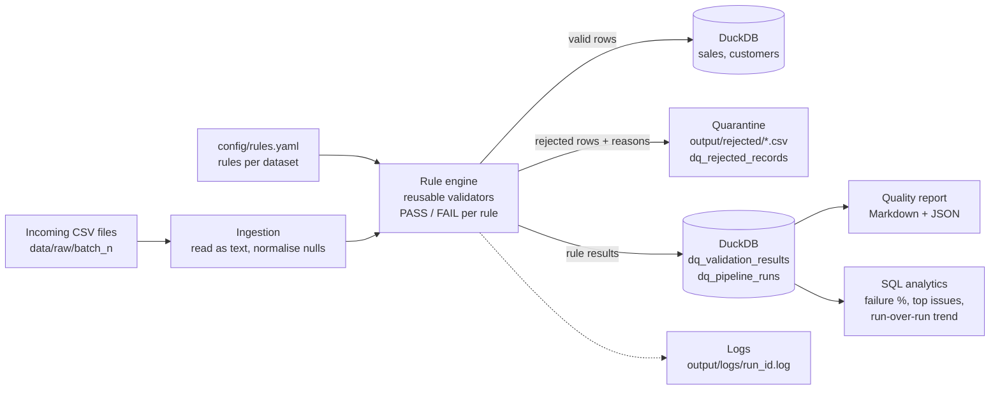

# Automated Data Quality Monitoring and Validation Framework

A small, config-driven framework that checks incoming CSV datasets before they
reach an analytical database. Good records are loaded into DuckDB, bad records
are quarantined with the reason they failed, and every rule's result is stored
so data quality can be tracked over time with SQL.

**Stack:** Python, Pandas, SQL, DuckDB, PyYAML, pytest. Free tools only.

## Architecture



Flow for each file: **ingest → validate → split → load valid / quarantine invalid → record results → report**.

## Project layout

```
dq_framework/
  ingestion.py     find and read CSV files (all columns as text)
  validators.py    9 reusable validation functions + registry
  engine.py        runs a dataset's rules, scores PASS/FAIL, builds reject reasons
  storage.py       DuckDB tables, typed load of valid rows, results storage
  report.py        Markdown + JSON quality report
  pipeline.py      orchestration, logging, run timestamps
config/rules.yaml  rules per dataset (the only file you edit to onboard data)
sql/analytics.sql  7 data quality queries
scripts/generate_sample_data.py   sample data with injected problems
data/raw/batch_1, batch_2         sample input (a bad day and a better day)
tests/             unit tests for validators and engine
docs/              sample quality report and analytics output
run_pipeline.py, run_analytics.py command-line entry points
```

## Quick start

```bash
python -m venv .venv && source .venv/bin/activate     # Windows: .venv\Scripts\activate
pip install -r requirements.txt

python scripts/generate_sample_data.py                # optional: files are already included
python run_pipeline.py --input data/raw/batch_1       # run 1: many problems
python run_pipeline.py --input data/raw/batch_2       # run 2: mostly clean
python run_analytics.py                               # SQL analytics across both runs
pytest -q                                             # unit tests
```

Outputs:

| Deliverable | Location |
|---|---|
| DuckDB database | `warehouse/dq.duckdb` |
| Clean data | tables `sales`, `customers` |
| Validation results table | `dq_validation_results` |
| Run tracking table | `dq_pipeline_runs` |
| Rejected records | `output/rejected/<run_id>/*.csv` and table `dq_rejected_records` |
| Quality report | `output/reports/dq_report_<run_id>.md` and `.json` |
| Logs | `output/logs/<run_id>.log` |

If the `duckdb` package is not installed, the pipeline logs a warning and uses
SQLite (`warehouse/dq.sqlite`) so it still runs. The SQL is written to work on both.

## Validation rules

| # | Rule type | Checks | Requirement covered |
|---|---|---|---|
| 1 | `required_columns` | mandatory columns exist; otherwise the whole file is rejected | mandatory columns |
| 2 | `not_null` | no missing values | missing values |
| 3 | `no_duplicate_rows` | no repeated identical rows (first copy is kept) | duplicate records |
| 4 | `unique` | key identifies exactly one record | primary key uniqueness |
| 5 | `dtype` | values can be cast to integer / float | data types |
| 6 | `valid_date` | real calendar date, right format, within min/max (e.g. not in the future) | invalid dates |
| 7 | `numeric_range` | value within min/max (`min: 0` bans negatives) | negative prices and quantities |
| 8 | `allowed_values` | value belongs to an accepted list | unexpected values |
| 9 | `regex` | value matches a pattern (email, ID format) | unexpected values |

Each rule gets a **PASS** or **FAIL** status. Two optional settings per rule:

- `severity: error` (default) rejects failing rows; `severity: warn` loads them and only reports.
- `max_failure_pct` sets a tolerance: the rule passes while the failure rate stays at or below it.

### Different rules for different datasets

Rules live in `config/rules.yaml`, one block per dataset. Onboarding a new feed
needs no Python:

```yaml
datasets:
  products:
    file_pattern: "products_*.csv"
    target_table: products
    primary_key: [product_id]
    schema: {product_id: string, name: string, list_price: float}
    rules:
      - {id: products_required, type: required_columns, columns: [product_id, list_price]}
      - {id: products_id_unique, type: unique, columns: [product_id]}
      - {id: products_price_ok, type: numeric_range, column: list_price, min: 0}
```

### Adding a new rule type

```python
# dq_framework/validators.py
@register("max_length")
def check_max_length(df, rule):
    s = df[rule["column"]].astype("string")
    return RuleOutcome((s.str.len() > rule["max"]).fillna(False))
```

## Sample data and the problems injected into it

`scripts/generate_sample_data.py` builds retail sales and customer files (seeded, so
results are reproducible) and corrupts a known number of rows:

| Problem | sales store_a (512 rows) | customers batch_1 (105 rows) |
|---|---|---|
| Missing values | 12 customer_id, 5 order_date | 4 email |
| Exact duplicate rows | 8 | 2 |
| Primary key conflicts | 4 pairs (8 rows) | 3 pairs (6 rows) |
| Wrong data type | 6 quantity (`abc`, `ten`, `3.5`) | |
| Invalid / future dates | 7 invalid, 3 future | 3 invalid |
| Negative numbers | 9 quantity, 6 unit_price | |
| Unexpected values | 10 payment_method, 6 category, 5 country (warn) | 4 segment, 6 bad email |

`sales_2026_01_legacy_export.csv` is missing the mandatory `unit_price` column and is
rejected as a file. `batch_2` contains the same feeds with only a few problems, so the
run comparison queries show an improvement.

Result of the two sample runs (see `docs/`):

| Run | Records processed | Loaded | Rejected | Rules failed |
|---|---|---|---|---|
| batch_1 | 869 | 707 | 162 (18.64%) | 20 of 38 |
| batch_2 | 701 | 690 | 11 (1.57%) | 7 of 23 |

### Using a real public dataset

The sample schema follows public retail datasets. To run a real one, such as the UCI
"Online Retail" dataset, drop the CSV in a folder and add a block to `rules.yaml` with
its column names (`InvoiceNo`, `StockCode`, `Quantity`, `InvoiceDate`, `UnitPrice`,
`CustomerID`, `Country`) and the date format used in your copy of the file. Its
missing customer IDs and negative quantities make it a realistic test.

## SQL analytics

`sql/analytics.sql` (run with `python run_analytics.py`):

1. Record failure percentage per run and dataset
2. Rule failure percentage per run
3. Most common issues by rule
4. Most common issue categories
5. Run-over-run reject trend per dataset (`LAG` window function)
6. Rule-by-rule comparison of the latest run with the previous one (FIXED / REGRESSED / STILL FAILING)
7. Files rejected outright

## How this maps to production data engineering

| Production practice | Where it appears here |
|---|---|
| **Quality gate before the warehouse**: bad data is stopped at ingestion, not found in dashboards | Validation runs before any load; only valid rows reach `sales` / `customers` |
| **Quarantine (dead-letter) pattern**: bad rows are set aside with a reason, good rows keep flowing | `output/rejected/` and `dq_rejected_records` with `_reject_reasons` and source line number |
| **Rules as configuration**: analysts and engineers review rules like code, new feeds need no new code | `config/rules.yaml` + validator registry |
| **Schema drift detection** | `required_columns` rejects the whole file |
| **Severity and thresholds**: not every issue should stop a load | `severity: error/warn`, `max_failure_pct` |
| **Raw data read as text, cast after validation**: no silent type coercion | `ingestion.read_csv`, `storage.load_clean` |
| **Idempotent loads**: re-running a file does not duplicate data | delete-by-primary-key then insert |
| **Lineage / auditability** | `_run_id`, `_source_file`, `_loaded_at` on every loaded row |
| **Observability**: quality metrics stored as data and trended | `dq_validation_results`, `dq_pipeline_runs`, SQL analytics, run timestamps, logs |
| **Tested pipeline code** | `tests/` |

The same ideas sit behind tools such as Great Expectations, dbt tests, Soda and AWS
Deequ: declarative expectations, stored results, and a decision to load, quarantine or stop.

## Possible next steps

- Swap the hand-written validators for Great Expectations suites, keeping the same results tables
- Referential integrity rule (every `sales.customer_id` exists in `customers`)
- Freshness and row-count anomaly checks (compare with the previous runs' volumes)
- Bulk loading through DuckDB's DataFrame scan instead of row inserts, for large files
- Schedule with cron or Airflow and alert (email / Slack) when a `severity: error` rule fails
- Read from and write to S3 (DuckDB `httpfs`) to turn this into a cloud pipeline
